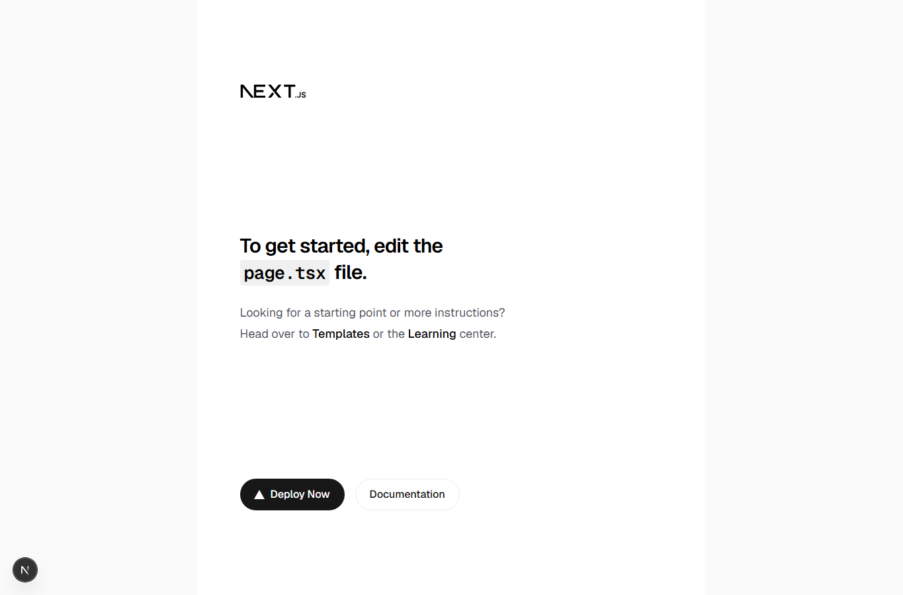

# WDD 430 W03 Team Project — Canvas Submission Draft

**Evidence status: draft; not ready for submission until the listed team and board evidence is confirmed.**
Repository reviewed on November 13, 2026: [Kelvingonzalezm/small-business-manager](https://github.com/Kelvingonzalezm/small-business-manager).

## 1. Team Meeting Summary — PARTIAL

My team selected Small Business Manager in a Microsoft Teams discussion, according to the team information available to me. I could not access the Teams meeting records in this review, so I cannot verify a synchronous meeting, its attendees, or a meeting leader. The repository and its issues record the project's scope, but they do not establish that individual responsibilities were agreed during a meeting. I will add those details only after the team confirms them.

The project is described in the README as a web application to help small business owners manage products, inventory, prices, and supplier information. The repository specification also includes account access and a basic business dashboard.

## 2. GitHub Repository — COMPLETE

Public team repository: [Small Business Manager](https://github.com/Kelvingonzalezm/small-business-manager)

The README lists four members: Kelvin Gonzalez, Virginia Rocha Guzman, Kenneth Duron, and Danson Nganga. This verifies the current repository roster, but not team numbering, meeting attendance, or assigned responsibilities. `main` is protected. A Git push dry-run to a temporary, non-created branch was accepted by GitHub; no branch or repository content was changed by that permission check.

## 3. Local Development Screenshot — PARTIAL

I cloned the team repository into a separate local folder, installed its locked npm dependencies, started `npm run dev`, and verified that `http://localhost:3000/` returned HTTP 200. I captured the actual page in headless Chrome; the image shows the current Next.js starter page. It does not show the address bar or VS Code terminal, so a screenshot with visible local URL/terminal context would be stronger evidence.

Optional stronger capture: keep the development server running in the project terminal, open `http://localhost:3000` in a browser, and press **Win + Shift + S**. Capture the browser with the localhost address visible, or capture VS Code with the project and terminal showing the `npm run dev` ready message. Save the original PNG without editing it.

## 4. GitHub Project Board — BLOCKED

No verified Project Board URL is available yet. The repository's classic Projects endpoint returned 404; GitHub CLI authentication is currently invalid, so I could not query Projects v2 or verify its visibility. The public Issues list contains seven open issues, below the assignment target of eight:

- [#5 — Implement user registration and login](https://github.com/Kelvingonzalezm/small-business-manager/issues/5)
- [#6 — Implement product management](https://github.com/Kelvingonzalezm/small-business-manager/issues/6)
- [#7 — Manage inventory and product prices](https://github.com/Kelvingonzalezm/small-business-manager/issues/7)
- [#8 — Implement supplier management](https://github.com/Kelvingonzalezm/small-business-manager/issues/8)
- [#9 — Create business dashboard](https://github.com/Kelvingonzalezm/small-business-manager/issues/9)
- [#10 — Build product creation and listing](https://github.com/Kelvingonzalezm/small-business-manager/issues/10)
- [#11 — Build product update and deletion](https://github.com/Kelvingonzalezm/small-business-manager/issues/11)

The public repository milestone list contains no milestones, so no issue is currently attached to a verified **Week 04** milestone. Issues #6, #10, and #11 overlap in product-management scope; the team should decide whether #10 and #11 are child tasks or duplicates before another issue is created. I did not create a board, issue, or milestone without confirming the existing Projects v2 board and team priority decisions.

## 5. Data Model — PARTIAL

The current [project specification](../specs/001-small-business-manager/spec.md) identifies four core concepts: User, Product, Supplier, and Inventory Record. I prepared a candidate model and relationships in [`wdd430-w03-planning-proposal.md`](wdd430-w03-planning-proposal.md). It is explicitly an individual proposal awaiting team approval. The draft does not assert a database choice: neither the specification nor the current application code records an approved or implemented database technology.

## 6. Design Planning — PARTIAL

I found no approved palette, typography, spacing rules, layout conventions, responsive standards, or shared UI library in the repository. The planning proposal includes a possible palette and interface direction, clearly marked for team discussion rather than as an accepted team decision. The repository currently contains the initial Next.js starter page.

## 7. W03 Team: Code Review Report — COMPLETE

My code-review evidence is the review already submitted on Kelvin Gonzalez's Week 02 Sacrament Meeting Planner PR: [Pull Request #1 review](https://github.com/Kelvingonzalezm/sacrament-meetings/pull/1#pullrequestreview-5899521998). This is the previously completed review; I did not repeat or replace it during this project audit.

## Verification performed

- `npm install`: completed; 362 packages added. npm reported 8 moderate advisories. No automated dependency fix was applied.
- `npm run lint`: passed.
- `npx tsc --noEmit`: passed.
- `npm run build`: passed; Next.js generated only `/` and `/_not-found`.
- `npm run dev`: started and reported ready at `http://localhost:3000`; an actual browser-rendered screenshot is saved at [`docs/evidence/local-development.png`](evidence/local-development.png).
- `GET http://localhost:3000/`: HTTP 200.
- The deployed homepage URL listed in the repository metadata returned HTTP 200, but it serves the Next.js starter. `/api/hello` returned HTTP 404. These are observations of the current deployment, not evidence of completed business features.
- `.env` is ignored by Git. No project source files were changed; the only intentional source change in this branch is the planning proposal and this report draft.

## Message for team confirmation (not sent)

> Hi team, I reviewed the WDD 430 W03 requirements for Small Business Manager. The repository currently has seven open issues and no Week 04 milestone visible through the public repository API, and I could not verify the Projects v2 board URL. Could someone share the current board link and confirm whether a board already exists? Please also confirm the synchronous meeting attendees and leader, the Week 04 priority issues, the database choice, and whether the draft User/Product/Supplier/Inventory Record model and proposed visual direction are acceptable. Issues #6 and #10/#11 overlap in product scope; could we decide whether those should be parent/child tasks before adding more work?

## Evidence still needed before Canvas submission

1. A genuine screenshot of the local project running.
2. The accessible GitHub Projects board URL, with at least eight relevant issues and the highest-priority issues linked to a Week 04 milestone.
3. Team confirmation of the database, data model, design decisions, priorities, work ownership, and asynchronous check-in plan.
4. Verified synchronous meeting attendees and leader, or instructor guidance on how to report if no synchronous meeting took place.
